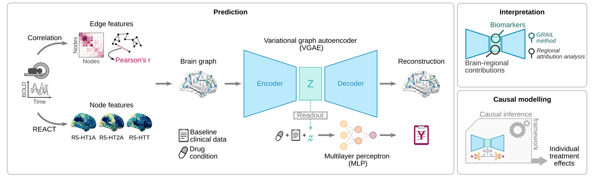
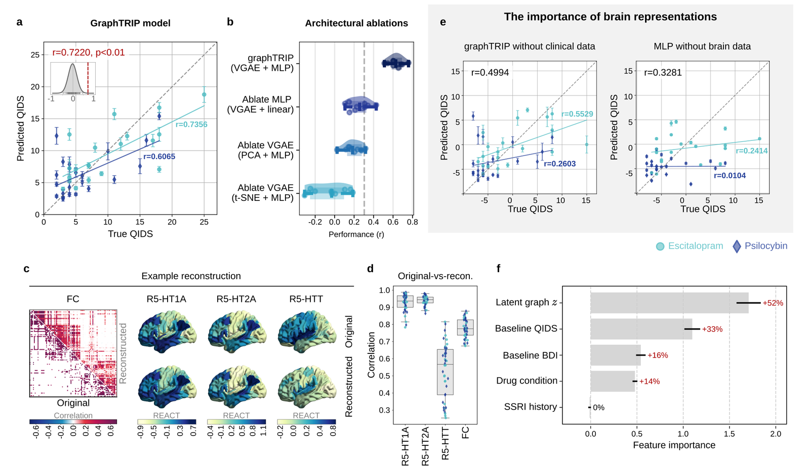

# graphTRIP: Graph-based Treatment Response Interpretability and Prediction

graphTRIP is a geometric deep learning pipeline that predicts antidepressant treatment response from pre-treatment brain imaging and clinical data. Each patient's brain is represented as a graph: nodes are brain regions carrying receptor-informed fMRI features (REACT maps for 5-HT1A, 5-HT2A and 5-HTT), and edges are the strongest functional connections. A variational graph-transformer autoencoder (VGAE) learns a latent representation of the graph, and an MLP predicts post-treatment depression severity (QIDS) from this representation, baseline clinical scores and the drug condition.

The repository contains the code for our study *Accurate and Interpretable Prediction of Antidepressant Treatment Response from Receptor-informed Neuroimaging*, including two extensions:

- **Medusa-graphTRIP**, a causal model with one prediction head per treatment, which estimates individual treatment effects (psilocybin vs. escitalopram).
- **GRAIL** (Gradient Alignment for Interpreting Latent-variable models), an interpretability method that tests which brain-graph biomarkers the model associates with treatment outcome, by measuring the alignment between the gradients of the prediction and of the biomarker in latent space.


*Brain graphs built from baseline fMRI are encoded by a VGAE; the latent representation, clinical data and drug condition are passed to an MLP that predicts post-treatment QIDS. GRAIL and regional attribution analysis explain the predictions, and a causal extension estimates individual treatment effects.*

## Key results

Trained on a double-blind randomised trial of psilocybin vs. escitalopram (NCT03429075), *N* = 42):

- graphTRIP predicts post-treatment QIDS with *r* = 0.72 (7-fold cross-validation, averaged over 10 seeds; *p* < 0.01 against 100 label-permutation nulls).
- It transfers to other brain atlases without retraining (Schaefer 200: *r* = 0.72; AAL: *r* = 0.60), because the encoder shares parameters across nodes and pools them into a fixed-size embedding.
- Applied zero-shot to an independent cohort with treatment-resistant depression (*N* = 16), its reconstructions are maintained and its predictions correlate with outcome (*r* = 0.53, *p* < 0.05).


*(a) True vs. predicted post-treatment QIDS; inset: label-permutation null. (b) Architectural ablations. (c, d) VGAE reconstructions of functional connectivity and REACT features. (e) Models trained without clinical or without brain data. (f) Permutation feature importance.*

## Repository structure

| Path | Contents |
| --- | --- |
| [`datasets.py`](datasets.py) | `BrainGraphDataset`, a PyTorch Geometric dataset built from parcellated fMRI, REACT maps and clinical annotations |
| [`models/`](models/) | Graph-transformer node encoder, VGAE, pooling layers, MLP and causal (two-head) prediction heads |
| [`experiments/`](experiments/) | [Sacred](https://github.com/IDSIA/sacred) experiments for training, atlas transfer, ablations, GRAIL, regional attributions and permutation importance; JSON configs in [`experiments/configs/`](experiments/configs/) |
| [`scripts/`](scripts/) | Entry points that run each analysis in the paper, and [`make_figures.py`](scripts/make_figures.py) for all figure panels |
| [`preprocessing/`](preprocessing/) | Brain-graph construction from fMRI and REACT map computation |
| [`figure_making/`](figure_making/) | Panel code for every main and supplementary figure |
| [`job_scripts/`](job_scripts/) | PBS array jobs that run the full analysis on an HPC cluster |
| [`utils/`](utils/) | Configs, file handling, statistics, plotting and cross-cohort harmonisation |
| [`notebooks/demo.ipynb`](notebooks/demo.ipynb) | End-to-end demo on synthetic data |

## Installation

Requirements: Linux (tested on Ubuntu 22.04 and CentOS/RHEL HPC clusters), Python 3.12, PyTorch 2.2, PyTorch Geometric 2.6 and at least 8 GB RAM. A GPU is optional; to use one, choose the PyTorch/CUDA build that matches your system (see the note in [`environment.yml`](environment.yml)).

```bash
git clone https://github.com/Imperial-MIND-lab/graphTRIP.git
cd graphTRIP
conda env create -f environment.yml
conda activate graphtrip
```

Installation takes about 15–20 minutes on a standard desktop.

## Quick start

[`notebooks/demo.ipynb`](notebooks/demo.ipynb) builds a small synthetic dataset (*n* = 10), loads it as a `BrainGraphDataset` and trains a model with [`experiments/configs/demo_config.json`](experiments/configs/demo_config.json). No neuroimaging data are required, and the demo takes about 10–30 seconds on a desktop.

## Applying graphTRIP to your own data

**1. Build a dataset.** A `BrainGraphDataset` is defined by a study, session and atlas:

```python
from datasets import BrainGraphDataset

dataset = BrainGraphDataset(study='psilodep2', session='before', atlas='schaefer100')
```

It reads one folder per subject, plus a table of graph-level attributes (e.g. clinical scores, treatment condition) with a `Patient` column matching the subject IDs:

```
data/raw/{study}/
├── annotations.csv
└── {session}/{atlas}/S{subject_id}/
    ├── node.csv
    ├── edge.csv
    └── bold.csv   (optional)
```

The attributes loaded by default are set in `Attrs.add_clinical_graph_attrs()` in [`datasets.py`](datasets.py). Pass `force_reload=True` after changing the raw files. We recommend including all candidate node, edge and graph features when the dataset is first built; models can then be trained on a subset via the config file.

**2. Train a model.** With a config in `experiments/configs/my_config.json`:

```bash
python -m experiments.run_experiment train_jointly FileStorageObserver --config_json=my_config.json
```

Results are written to `outputs/runs/train_jointly/{config_name}/` unless `output_dir` is set in the config or on the command line; `--seed` and `--jobid` add subdirectories. Experiments can log to [Neptune.ai](https://neptune.ai/) instead of the `FileStorageObserver` if you export a Neptune API token.

Sparse graphs work best: fully connected graphs increase training time and often cause oversmoothing.

## Reproducing the paper

Reproducing the results requires access to the two clinical datasets (`psilodep2`, primary; `psilodep1`, independent validation), which are available on request as described in the paper's Data availability statement, and to the open-access receptor density maps listed there. Expected layout:

```
data/raw/
├── psilodep1/
├── psilodep2/                 # annotations.csv and before/schaefer100/S*/
├── receptor_maps/schaefer100/schaefer100_receptor_maps.csv
├── spatial_coordinates/Schaefer2018_100Parcels_7Networks_order_FSLMNI152_2mm.Centroid_RAS.csv
└── transmodal_axis/Schaefer100_SA_Axis.csv
```

`data/processed/` is written by PyTorch Geometric; do not place files there.

1. Compute REACT maps as described in [`preprocessing/react/react_readme.md`](preprocessing/react/react_readme.md).
2. Run the job scripts from the repository root, in order:

   ```bash
   qsub job_scripts/preprocessing.sh
   qsub job_scripts/train.sh           # after preprocessing
   qsub job_scripts/post_training.sh   # after train
   qsub job_scripts/grail.sh           # after train
   qsub job_scripts/posthoc.sh         # after post_training and grail
   ```

   [`job_scripts/README.md`](job_scripts/README.md) describes what each job writes and which figures read it, and how to launch the permutation nulls. A single graphTRIP training run (7-fold CV, 300 epochs per fold, one seed; [`scripts/graphtrip.py`](scripts/graphtrip.py)) takes about 27 minutes on one AMD EPYC 7742 node.
3. Generate the figures (a few minutes on a laptop):

   ```bash
   python -m scripts.make_figures                      # all targets, as svg
   python -m scripts.make_figures fig2 fig4 --fmt png  # selected targets
   python -m scripts.make_figures --list               # available targets
   ```

   Each target writes its panels, tables and a `stats.txt` report to `notebooks/figures/<folder>/`.

## Citation

Tolle, H. M., Luppi, A. I., Lawn, T., Roseman, L., Nutt, D., Carhart-Harris, R. L., & Mediano, P. A. M. (2025). *Accurate and Interpretable Prediction of Antidepressant Treatment Response from Receptor-informed Neuroimaging.*

## License

BSD 3-Clause; see [LICENSE](LICENSE).
